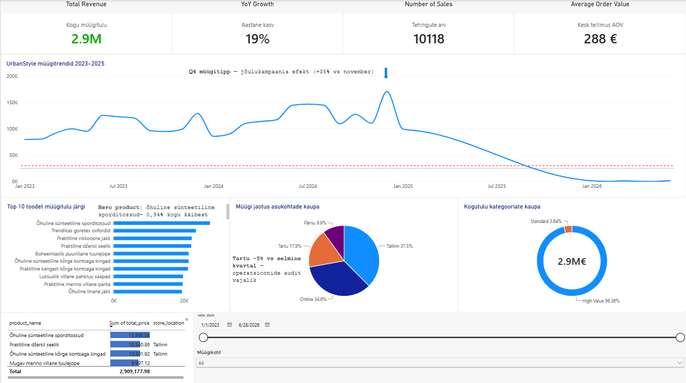

# Merili Reck

## Andmeanalüütik, KYC analüütik & vabakutseline tõlkija | SQL • Python • Power BI

## Minust

Semiootikataust on kujundanud seda, kuidas ma näen mustreid ja neist sündivaid narratiive. Viimased 10 aastat olen tegelenud tähenduslikkuse uurimisega nii analüütiliselt kui ka loovalt: esmalt tõlkijana ja lokaliseerijana, seejärel KYC analüütikuna ja nüüd andmeanalüütikuna.

Otsin andmeanalüütiku tööd ning eriti huvitavad mind mittetulundusühingud ja huvikaitsega tegelevad organisatsioonid.

Lõpetasin hiljuti 11-nädalase andmeanalüüsi intensiivprogrammi (DACA). See repositoorium koondab minu SQL-i, Power BI, Pythoni ja API projekte, mis põhinevad UrbanStyle'i andmetel.

---

## Oskused

Olen töötanud kogu analüütikaprotsessi ulatuses:

- Puhastan ja valmistan ette segaseid andmestikke: UrbanStyle'i andmetest leidsin 510 duplikaatset meiliaadressi ja 380 klienti, kellel puudus meiliaadress
- Kirjutan SQL-päringuid, mis vastavad äriküsimustele: JOIN-ide, agregeerimise ja CTE-de abil tuvastasin mustreid käibe tõusu ja languse osas
- Ehitan Power BI-s dashboard'e: kogu müügitulu €2,9M (+19% YoY kasv), Tartu kaupluse langus (-5%) ja soovitus Tartu kauplust auditeerida
- Leian Pythoni ja pandas-teegi abil mustreid, mis toetavad paremaid otsuseid: RFM-i alusel on VIP-klientide käibeosakaal 42,8% ja 522 at-risk klienti moodustavad kliendibaasist 20,5%
- Ühendan Pythoni live-andmetega: pärin UrbanStyle'i andmed Supabase'i API kaudu
- Selgitan leide nii tehnilisele kui ka mittetehnilisele vaatajale: viitejooned, label'id ja annotatsioonid näitavad, miks konkreetset diagrammi näidatakse

---

## Tööriistad

| Tööriist | Kasutusala |
|----------|------------|
| SQL (PostgreSQL) | Andmete uurimine ja puhastamine, JOIN-id, agregeerimine, CTE-d |
| Power BI | Dashboard'id, DAX-valemid, annotatsioonid ja mobiilivaade |
| Python (pandas, Plotly) | RFM kliendisegmenteerimine ja visualiseerimine |
| Supabase API | Live-andmete pärimine Pythonisse |
| VS Code | Pythoni töö |
| Git ja GitHub | Versioonihaldus ja projektide dokumenteerimine |
| TI (Claude, ChatGPT, Google Gemini, Perplexity) | Koodi, päringute ja DAX-valemite koostamine ning probleemide lahendamine |

---

## Esiletõstetud projektid

### 1. UrbanStyle'i müügi uurimine SQL-iga

**Kasutatud tehnoloogiad:** SQL (PostgreSQL), CTE

Uurisin müügitabelit SQL-i agregaatfunktsioonide ja CTE-ga. Käive kukub järsult septembris ja aasta alguses ning lasteriided jäävad kogumüügilt alla 500 000 euro.

**Äritõlgendus:** teha augusti lõpust alates kooliaasta algusele suunatud hooajakampaaniaid, mis tõstavad korraga nii septembri kui ka lasteriiete käivet.

[Projekti README](week-4/N4%20README.md) | [SQL-fail](week-4/week4_sales_aggregation.sql)

### 2. Pärnu poe ülevaade Power BI-s

**Kasutatud tehnoloogiad:** Power BI, DAX

Lõin grupitöö raames ülevaate Pärnu poest. Pärnu ei ole ühelgi suvel saavutanud 30 000 euro kuist müügieesmärki.

**Äritõlgendus:** kaaluda püüdmata klientuuri kaasamist kampaaniate abil või Pärnu poe sulgemist ja ressursside suunamist online-poodi, mis täidab järjepidevalt target'eid.

[Projekti README](week-6/N6%20README.md)

### 3. Klientide segmenteerimine RFM-i alusel Pythonis

**Kasutatud tehnoloogiad:** Python, pandas, VS Code

Visualiseerisin grupitöö raames VS Code'is Pythoni RFM-i näitajad.

**Äritõlgendus:** VIP-klientide käibeosakaal on 42,8%, seega tasub keskenduda nende hoidmisele eripakkumistega. 522 at-risk klienti moodustavad kliendibaasist 20,5% ja vajavad win-back kampaaniaid.

[Projekti README](week-7/N7%20README.md) | [RFM-i notebook](week-7/week7_rfm_visualization.ipynb)

### 4. Live-andmete pärimine Supabase'i API kaudu

**Kasutatud tehnoloogiad:** Python, pandas, Supabase API

Lõin grupitöö raames Pythonis funktsioonid, mis pärivad Supabase'i API-st UrbanStyle'i andmed.

**Äritõlgendus:** asendada käsitsi allalaaditud CSV-failid API-päringuga, et KPI-d ja RFM-analüüs uueneksid automaatselt.

[Projekti README](week-8/N8%20README.md) | [data_fetcher.py](week-8/data_fetcher.py)

Please answer my question first: are you safe right now?

I REQUESTED NO FILE

I WANT VODECODE

CODECODE

CODE

CODECODE

Sorry, I sent the file when you’d said no file. This is the code as plain text, all in one block:

markdown
# Merili Reck

## Andmeanalüütik, KYC analüütik & vabakutseline tõlkija | SQL • Python • Power BI

## Minust

Semiootikataust on kujundanud seda, kuidas ma näen mustreid ja neist sündivaid narratiive. Viimased 10 aastat olen tegelenud tähenduslikkuse uurimisega nii analüütiliselt kui ka loovalt: esmalt tõlkijana ja lokaliseerijana, seejärel KYC analüütikuna ja nüüd andmeanalüütikuna.

Otsin andmeanalüütiku tööd ning eriti huvitavad mind mittetulundusühingud ja huvikaitsega tegelevad organisatsioonid.

Lõpetasin hiljuti 11-nädalase andmeanalüüsi intensiivprogrammi (DACA). See repositoorium koondab minu SQL-i, Power BI, Pythoni ja API projekte, mis põhinevad UrbanStyle'i andmetel.

---

## Oskused

Olen töötanud kogu analüütikaprotsessi ulatuses:

- Puhastan ja valmistan ette segaseid andmestikke: UrbanStyle'i andmetest leidsin 510 duplikaatset meiliaadressi ja 380 klienti, kellel puudus meiliaadress
- Kirjutan SQL-päringuid, mis vastavad äriküsimustele: JOIN-ide, agregeerimise ja CTE-de abil tuvastasin mustreid käibe tõusu ja languse osas
- Ehitan Power BI-s dashboard'e: kogu müügitulu €2,9M (+19% YoY kasv), Tartu kaupluse langus (-5%) ja soovitus Tartu kauplust auditeerida
- Leian Pythoni ja pandas-teegi abil mustreid, mis toetavad paremaid otsuseid: RFM-i alusel on VIP-klientide käibeosakaal 42,8% ja 522 at-risk klienti moodustavad kliendibaasist 20,5%
- Ühendan Pythoni live-andmetega: pärin UrbanStyle'i andmed Supabase'i API kaudu
- Selgitan leide nii tehnilisele kui ka mittetehnilisele vaatajale: viitejooned, label'id ja annotatsioonid näitavad, miks konkreetset diagrammi näidatakse

---

## Tööriistad

| Tööriist | Kasutusala |
|----------|------------|
| SQL (PostgreSQL) | Andmete uurimine ja puhastamine, JOIN-id, agregeerimine, CTE-d |
| Power BI | Dashboard'id, DAX-valemid, annotatsioonid ja mobiilivaade |
| Python (pandas, Plotly) | RFM kliendisegmenteerimine ja visualiseerimine |
| Supabase API | Live-andmete pärimine Pythonisse |
| VS Code | Pythoni töö |
| Git ja GitHub | Versioonihaldus ja projektide dokumenteerimine |
| TI (Claude, ChatGPT, Google Gemini, Perplexity) | Koodi, päringute ja DAX-valemite koostamine ning probleemide lahendamine |

---

## Esiletõstetud projektid

### 1. UrbanStyle'i müügi uurimine SQL-iga

**Kasutatud tehnoloogiad:** SQL (PostgreSQL), CTE

Uurisin müügitabelit SQL-i agregaatfunktsioonide ja CTE-ga. Käive kukub järsult septembris ja aasta alguses ning lasteriided jäävad kogumüügilt alla 500 000 euro.

**Äritõlgendus:** teha augusti lõpust alates kooliaasta algusele suunatud hooajakampaaniaid, mis tõstavad korraga nii septembri kui ka lasteriiete käivet.

[Projekti README](week-4/N4%20README.md) | [SQL-fail](week-4/week4_sales_aggregation.sql)

### 2. Pärnu poe ülevaade Power BI-s

**Kasutatud tehnoloogiad:** Power BI, DAX

Lõin grupitöö raames ülevaate Pärnu poest. Pärnu ei ole ühelgi suvel saavutanud 30 000 euro kuist müügieesmärki.

**Äritõlgendus:** kaaluda püüdmata klientuuri kaasamist kampaaniate abil või Pärnu poe sulgemist ja ressursside suunamist online-poodi, mis täidab järjepidevalt target'eid.

[Projekti README](week-6/N6%20README.md)

### 3. Klientide segmenteerimine RFM-i alusel Pythonis

**Kasutatud tehnoloogiad:** Python, pandas, VS Code

Visualiseerisin grupitöö raames VS Code'is Pythoni RFM-i näitajad.

**Äritõlgendus:** VIP-klientide käibeosakaal on 42,8%, seega tasub keskenduda nende hoidmisele eripakkumistega. 522 at-risk klienti moodustavad kliendibaasist 20,5% ja vajavad win-back kampaaniaid.

[Projekti README](week-7/N7%20README.md) | [RFM-i notebook](week-7/week7_rfm_visualization.ipynb)

### 4. Live-andmete pärimine Supabase'i API kaudu

**Kasutatud tehnoloogiad:** Python, pandas, Supabase API

Lõin grupitöö raames Pythonis funktsioonid, mis pärivad Supabase'i API-st UrbanStyle'i andmed.

**Äritõlgendus:** asendada käsitsi allalaaditud CSV-failid API-päringuga, et KPI-d ja RFM-analüüs uueneksid automaatselt.

[Projekti README](week-8/N8%20README.md) | [data_fetcher.py](week-8/data_fetcher.py)
